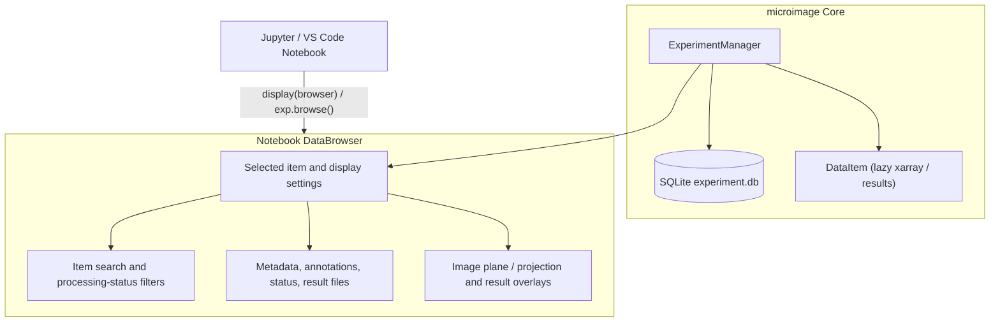

# Implementation Plan: Notebook Data Browser

## Goal

Provide a read-only interactive browser for microscopy datasets managed by
`ExperimentManager`, primarily for use in Jupyter and VS Code notebooks. The
browser should make it easy to find a scene, inspect its metadata and image,
and view results already registered with the experiment.

The browser must preserve lazy access to image data: load and render only the
selected scene and requested frame, channel, plane, or projection rather than
eagerly materializing whole datasets.

## V1 Scope

- Integrate with notebooks using the existing `ipywidgets` dependency.
- Filter and search items by container path, scene, processing status, and
  metadata or annotated metadata.
- Show dimensions (`T`, `C`, `Z`, `Y`, `X`), physical scales, channels,
  annotations, registered result files, and processing errors.
- Inspect image planes and maximum-intensity projections across channels, with
  display controls such as colormaps, percentile limits, and gamma.
- Show compatible registered results, such as segmentation contours and point
  overlays, when present.
- Keep the UI read-only: it does not edit annotations, results, or the
  experiment database.

### Processing status is not annotation-review status

The current data model's `processed` and `error` fields describe pipeline
execution. They do not indicate whether an image has been annotated, reviewed,
approved, or returned for changes. V1 may filter by processing status, but
must label it as such and must not present it as annotation-review status.
Adding a review workflow would require a separately designed status model.

## Decisions and Deferred Scope

### Standalone and web delivery

Standalone/web delivery is not part of v1. Revisit it after the notebook
browser's interface and needs are established. Select a serving approach and
document its dependencies, install instructions, launch behavior, and required
project paths before promising a CLI such as `microimage browse`.

In particular, Voilà is an additional package and serves notebook apps; it
does not by itself provide a CLI application from a `DataBrowser` object.
`ExperimentManager` also requires the data and results directories, not only a
database path. Solara or a FastAPI/Starlette application would introduce
different runtime or UI architecture choices and should be evaluated
explicitly rather than described as zero-dependency alternatives.

### Annotation editing

Annotation editing is not part of v1. The existing annotations represent
semantic channel names and metadata; masks, tables, and contours are registered
processing results. Editing geometric annotations in the viewer is a distinct
feature that needs an explicit annotation representation, persistence through
the manager, validation, and safe write behavior.

If editing is later required, decide separately whether it covers metadata and
channel annotations, geometric labels, or both. Do not write directly to
SQLite from UI callbacks; route persistence through `ExperimentManager`.

## Related Project Patterns

- **Roboflow** combines dataset search/filtering with an annotation interface
  and explicit annotation jobs/reviewer workflows. It also provides image
  comments and annotation history. Those review and collaboration features
  depend on explicit workflow state; they are not equivalent to microimage's
  processing status.
  - [Dataset search](https://docs.roboflow.com/datasets/manage/manage-datasets/dataset-search)
  - [Annotation workflow](https://docs.roboflow.com/datasets/annotate/annotate/manage-annotation-workflow)
  - [Annotate an image](https://docs.roboflow.com/datasets/annotate/annotate/use-roboflow-annotate)
- **LabelMe** is a local GUI for opening an image or directory, annotating
  geometry, and saving JSON annotations. It is useful precedent for local
  image navigation and annotation interaction, but it does not supply
  Roboflow-style team assignment and review workflow.
  - [LabelMe README](https://github.com/wkentaro/labelme)

Microimage's v1 is a dataset and results browser, not a replacement for either
project's full annotation/review workflow.

## Component Architecture



## Proposed Changes

### `src/microimage/ui.py`

Implement `DataBrowser` using `ipywidgets` with small, cohesive components:

- **Item selector**
  - Search by container path and scene.
  - Filter by processing status: `All`, `Processed`, `Unprocessed`, `Error`.
  - Search/filter metadata and annotated metadata where practical.
  - Use a scrollable or paginated item list and show the matching item count.
- **Image viewer**
  - Provide channel visibility and colormap controls.
  - Select time frame and Z plane, with an explicit maximum-intensity
    projection option.
  - Provide display controls such as percentile limits and gamma.
  - Show compatible registered contours or point results and a scalebar when
    calibration is available.
  - Load and compute only the selected scene and requested view. Do not assume
    `manager.show_data` supports plane/time selection; use or extend the
    manager's data-loading/rendering path as needed.
- **Item details**
  - Show dimensions, pixel scales, physical channel names, raw and annotated
    metadata, processing status/error, and registered result files.
- **DataBrowser**
  - Combine the selector, viewer, and details panel in a notebook-friendly
    layout.
  - Support display by evaluating the object and an explicit `show()` method
    if consistent with the chosen widget implementation.

### `src/microimage/manager.py`

Add a convenience method that constructs the browser without importing UI
dependencies until requested:

```python
def browse(self) -> "DataBrowser":
    """Create a read-only browser for this experiment."""
    from .ui import DataBrowser

    return DataBrowser(self)
```

No CLI or standalone server is proposed for v1.

## Verification Plan

### Automated tests

Add `test/test_ui.py` to cover:

- Constructing and displaying a browser for a manager with test items.
- Searching and filtering by processing status, including error items.
- Selecting an item updates its displayed metadata and registered results.
- Rendering supported 2D and multidimensional test data does not raise errors.
- Image view selection computes only the requested plane or projection where
  the data backend allows that behavior.
- Missing calibration or unavailable overlays are handled clearly without
  preventing the base image and item details from displaying.

Run targeted UI tests, then `uv run pytest test/` and `uv run ruff check
src/microimage/ui.py`.

### Manual verification

In a notebook, construct an `ExperimentManager`, scan or load a test experiment,
then call `browser = exp.browse()` and display `browser`. Verify search,
processing-status filters, item details, channel/frame/plane controls, and
available result overlays. Confirm the UI does not alter annotations,
processing state, or result files.
